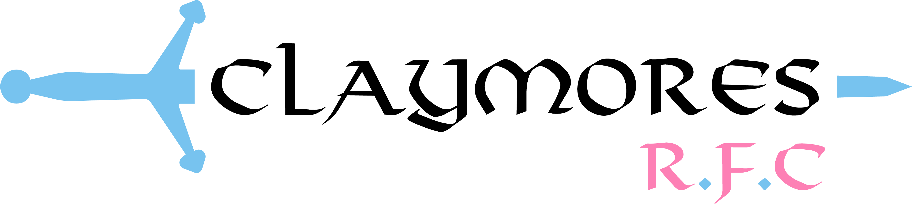
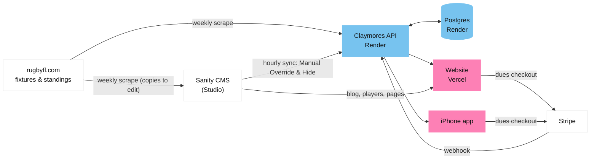
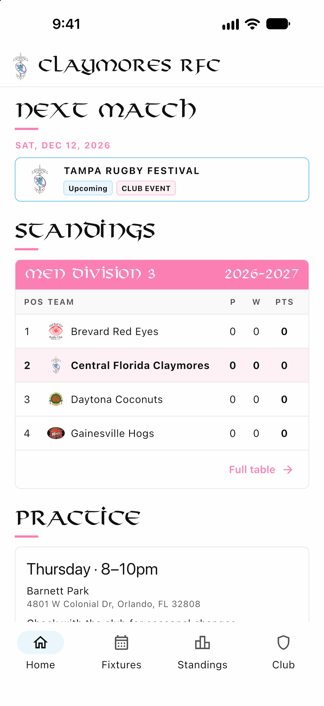
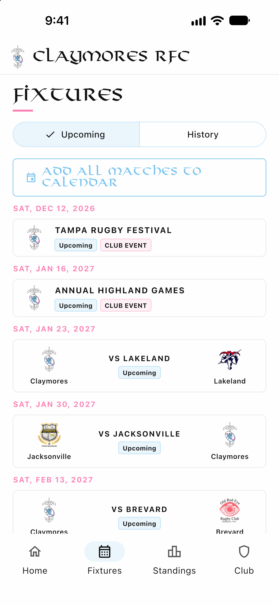
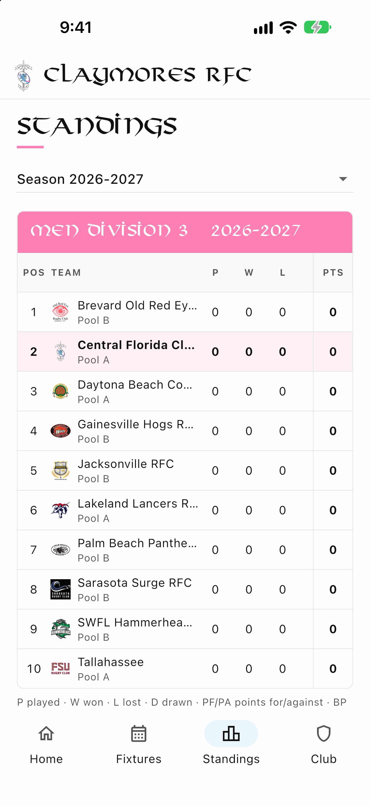
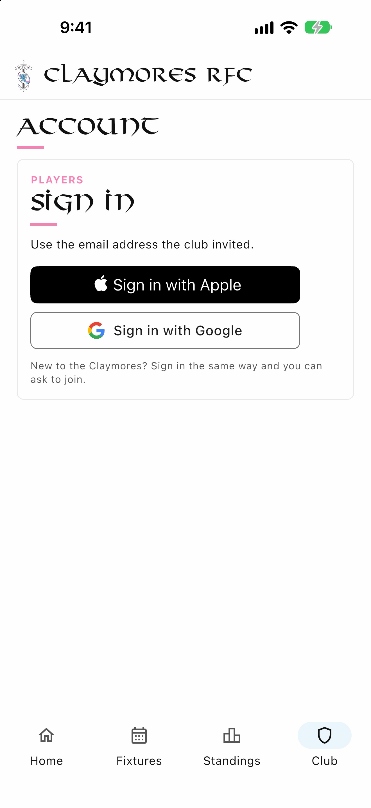

<p align="center">
  
</p>

<p align="center">
  <b>Central Florida Claymores RFC</b> · Orlando's rugby club since 2018<br>
  The website, the API and the iPhone app, in one repository.
</p>

<p align="center">
  <a href="https://www.claymoresrfc.com"></a>
  <a href="https://claymores-api-4zm4.onrender.com/swagger"></a>
  <a href="https://github.com/CarlosLavayenJr/Claymore-Website/actions/workflows/ios-testflight.yml"></a>
</p>

---

## Where everything lives

| | What | Link |
| --- | --- | --- |
| 🌐 | **Website** (Next.js on Vercel) | [claymoresrfc.com](https://www.claymoresrfc.com) · [Vercel project](https://vercel.com/carlos-lavayens-projects/claymore-website) |
| ✏️ | **CMS** (Sanity Studio, inside the site) | [claymoresrfc.com/studio](https://www.claymoresrfc.com/studio) |
| 🛡️ | **Club Admin** (join requests, invitations, dues) | [claymoresrfc.com/account/admin](https://www.claymoresrfc.com/account/admin) · in the app: Club → Profile → Club Admin |
| ⚙️ | **API** (ASP.NET Core on Render) | [Swagger](https://claymores-api-4zm4.onrender.com/swagger) · [health](https://claymores-api-4zm4.onrender.com/health/ready) · [Render dashboard](https://dashboard.render.com) (`claymores-api-4zm4`) |
| 🗄️ | **Database** (Postgres on Render) | Render dashboard → `claymores-db-4zm4`. See [Looking at the database](#looking-at-the-database) |
| 📱 | **iPhone app** (Flutter) | TestFlight · [App Store Connect](https://appstoreconnect.apple.com) · [cloud build](https://github.com/CarlosLavayenJr/Claymore-Website/actions/workflows/ios-testflight.yml) |
| 💳 | **Payments** | [Stripe dashboard](https://dashboard.stripe.com) (test mode until the account is verified) |
| 🔑 | **Google sign-in** | [Google Cloud](https://console.cloud.google.com/auth/clients?project=claymores-rfc) project `claymores-rfc` |
| 🗓️ | **Scheduled jobs** | Render cron jobs (scrapers, CMS sync) · Vercel crons (CMS copies) · [GitHub Actions](https://github.com/CarlosLavayenJr/Claymore-Website/actions) (Sanity backup, iOS builds) |

## How it fits together



- **Fixtures and standings** come from rugbyfl.com into the API's database. When rugbyfl.com is wrong, fix the match in **Studio**: tick **Manual Override** (scores, teams, dates) or **Hide this match** (games that never happened). The hourly `claymores-sync-cms` job copies the fix to the API. More in [api/README.md](api/README.md#fixing-scraped-data-in-the-cms).
- **Everything else on the site** (blog, players, coaches, practices, pages) is edited in Studio as before.
- **Members** sign in with Google (website and app) or Apple (app). One person is one member: the same email, or an Apple ID linked on the app's profile, opens the same account.

## The app

<p align="center">
  
  
  
  
</p>

Public for everyone: next match, fixtures and results, standings, practice times. Members sign in for their dues; admins get Club Admin. Releasing is in [mobile/store/APP_STORE.md](mobile/store/APP_STORE.md).

## Common tasks

<details>
<summary><b>Fix a game rugbyfl.com got wrong</b></summary>

1. Open [Studio](https://www.claymoresrfc.com/studio) → Match → find the game.
2. Wrong details: correct them and tick **Manual Override**. A game that never happened: tick **Hide this match** (don't delete it).
3. Publish. The website and app update within the hour.
</details>

<details>
<summary><b>Invite a member or approve a request to join</b></summary>

Club Admin (website or app) → **Join requests** → Approve, or **Invitations** → invite by email as player or admin. They sign in with that Google account or Apple ID.
</details>

<details>
<summary><b>Dues: assign, see who has paid, record cash</b></summary>

Club Admin → **Manage dues**:
- assign to one player or **Everyone who has signed in**, or turn on **Automatic dues** so every player gets them on first sign-in;
- the summary shows, per dues item, who has paid in full, partly or not at all;
- record cash, Venmo, Zelle or check payments with a note (also in the app, at practice).

Card payments go through Stripe Checkout (test mode until the Stripe account is verified; going live is in [api/README.md](api/README.md#going-live-with-stripe)).
</details>

<details>
<summary><b>Ship a new version of the app</b></summary>

GitHub → **Actions → iOS TestFlight → Run workflow** (on `main`). About 20 minutes later the build is in TestFlight; the build number goes up on its own. To release it, pick the build on the version page in App Store Connect and submit.
</details>

<details>
<summary><b>Release website or API changes</b></summary>

Work lands on `dev` first (its preview: `claymore-website-git-dev-carlos-lavayens-projects.vercel.app`), then a pull request `dev` → `main`. Merging to `main` deploys the website (Vercel) and the API (Render) automatically. Vercel skips builds that only touch `api/` or `mobile/`.
</details>

## Looking at the database

The database only accepts connections from Render's own network, on purpose. To look around:

- **Render dashboard** → `claymores-db-4zm4`: size, metrics, backups.
- **From your computer:** Render dashboard → `claymores-db-4zm4` → **Networking / Access Control** → add your IP, then `render psql claymores-db-4zm4` (or paste the *External Database URL* into TablePlus/Postico). Remove your IP when done.

Main tables: `fixtures`, `standings`, `teams`, `club_members` and `member_identities` (who can sign in, as one member), `club_invitations`, `join_requests`, `dues_assessments`, `dues_payments`, `dues_checkouts`, `dues_auto_assign`. Schema changes are the numbered files in [`api/src/Claymores.Api/sql`](api/src/Claymores.Api/sql), applied automatically on deploy.

## Repository layout

| Folder | What | Deploys to | Docs |
| --- | --- | --- | --- |
| `/` | Next.js 16 website + Sanity Studio (`/studio`) | Vercel | [docs/website.md](docs/website.md) · [CLAUDE.md](CLAUDE.md) (pages, SEO) · [STYLING.md](STYLING.md) (design) |
| `api/` | ASP.NET Core 10 API, scrapers, tests | Render ([`render.yaml`](render.yaml)) | [api/README.md](api/README.md) |
| `mobile/` | Flutter app | TestFlight / App Store | [mobile/README.md](mobile/README.md) · [mobile/store/APP_STORE.md](mobile/store/APP_STORE.md) |
| `backups/` | Weekly Sanity dataset backups | (GitHub Action) | |
| `scripts/` | One-off Sanity scripts and the local mock API | | |

## Running it locally

```bash
npm ci && npm run dev                       # website on http://localhost:3000
```

```bash
cd api && dotnet test                       # API tests (set CLAYMORES_TEST_DATABASE for the Postgres ones)
```

```bash
cd mobile && flutter run --dart-define-from-file=dart_defines/production.json
```

Details, environment variables and test commands are in each folder's docs above.

## Secrets: where they live

Never in the repository. Names only:

| Where | Secrets |
| --- | --- |
| **Render** (`claymores-api-4zm4` → Environment) | `Authentication__Google__ClientSecret`, `Stripe__SecretKey`, `Stripe__WebhookSecret`, `Authentication__Tokens__SigningKey` (generated), `Authentication__Apple__PrivateKey` (optional) |
| **Vercel** (claymore-website → Settings → Environment Variables) | `AUTH_SECRET`, `AUTH_GOOGLE_SECRET`, `RESEND_API_KEY`, `TURNSTILE_SECRET_KEY`, `SANITY_API_TOKEN`, `SANITY_REVALIDATE_SECRET`, `CRON_SECRET` |
| **GitHub** (Settings → Secrets → Actions) | `APP_STORE_CONNECT_KEY`, `APP_STORE_CONNECT_KEY_ID`, `APP_STORE_CONNECT_ISSUER_ID`, `SANITY_API_TOKEN`, `SANITY_PROJECT_ID` |

<p align="center"><sub>Built for the Claymores · <a href="https://www.claymoresrfc.com/contact">come to a practice</a></sub></p>
